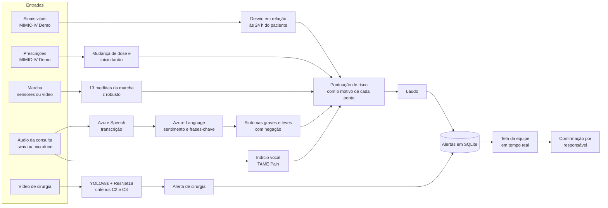

# Relatório Técnico: OmniCare AI

Tech Challenge Fase 4, Pós-Tech IA para Devs (FIAP). Protótipo acadêmico de monitoramento hospitalar multimodal. Não foi validado clinicamente e serve como apoio à decisão, não como diagnóstico.

## 1. Objetivo

O desafio pede um sistema que analise texto, áudio e vídeo de pacientes para identificar sinais precoces de risco, use serviços de nuvem (Azure) e avise a equipe médica quando detectar anomalias. O OmniCare AI entrega:

1. **Vídeo:** análise de vídeo de cirurgia (YOLOv8s e ResNet18) e de marcha (MediaPipe Pose), com relatório de desvios.
2. **Áudio:** transcrição com Azure Speech to Text, sentimento e sintomas com Azure Language (Text Analytics) e um indício vocal a partir da voz.
3. **Anomalias:** sinais vitais, prescrições e movimentação, com pontuação de risco e alerta confirmado por uma pessoa da equipe.

## 2. Fluxo multimodal



Cada resultado de uma internação (marcha e fala) fica guardado no contexto do paciente. A pontuação de risco soma o que está ativo no momento, guarda o motivo de cada ponto e gera um laudo em texto. Quando o nível passa de "baixo", o sistema grava um alerta. A tela recebe os alertas por *Server-Sent Events* (atualização a cada 1 s) e uma pessoa confirma que viu, informando o nome. A primeira confirmação é preservada.

O alerta de cirurgia é separado: um desvio gera um alerta próprio, de nível "atenção".

## 3. Modelos aplicados em cada tipo de dado

| Dado | Base | Modelo ou método | Saída |
|---|---|---|---|
| Sinais vitais (FC, FR, SpO2, PA sistólica, temperatura) | MIMIC-IV Demo 2.2 (140 internações) | Distância robusta (mediana e MAD) de cada valor até as 24 h anteriores do próprio paciente, sem olhar o futuro. Limiar 3,0, desvio mantido por 2 horas seguidas | Eventos com valor, referência do paciente e desvio |
| Prescrições | MIMIC-IV Demo 2.2 | Razão entre doses consecutivas (≥ 2 moderada, ≥ 5 alta) e início tardio (> 24 h), com lista de medicamentos de alerta | Eventos de prescrição com gravidade |
| Marcha (sensores) | Multi-Gait-Posture (14 pessoas, 367 caminhadas) | 13 medidas por janela e pontuação z robusto contra a referência | Alerta e medida mais distante |
| Marcha (vídeo) | Vídeo enviado | MediaPipe Pose gera o esqueleto, e as mesmas medidas e referência são usadas | Igual à marcha por sensores |
| Voz (som) | TAME Pain (51 pessoas) | Medidas acústicas (MFCC, delta, energia, ZCR, centroide, F0) e regressão logística, calibrada pela gravação em repouso da mesma pessoa | Indício vocal presente ou ausente |
| Fala (conteúdo) | Consulta gravada | Azure Speech to Text, Azure Language e uma lista de sintomas com tratamento de negação | Transcrição, sentimento, frases-chave e sintomas |
| Vídeo de cirurgia | Endoscapes2023 (201 vídeos) | YOLOv8s para estruturas e ResNet18 para os critérios C1, C2 e C3 da Visão Crítica de Segurança, 1 frame a cada 5 s | Desvio por vídeo, séries por critério e estruturas |

**Sobre o OpenPose.** O desafio cita OpenPose como exemplo. A marcha por vídeo usa o MediaPipe Pose, que cumpre a mesma função (estimar a pose do corpo) e instala com `pip`, sem compilar. O YOLOv8 é usado na detecção de estruturas e instrumentos da cirurgia.

### 3.1 Integração com o Azure

| Serviço | Recurso | Uso |
|---|---|---|
| Azure Speech to Text (região eastus) | Reconhecimento contínuo em `pt-BR` | Transcreve a consulta inteira |
| Azure Language | Análise de sentimento e extração de frases-chave | Sentimento da consulta e frases-chave |

Detalhes do que foi feito para funcionar com consultas reais:

- **Reconhecimento contínuo.** O modo de reconhecimento único para na primeira pausa (até cerca de 30 s). O serviço usa reconhecimento contínuo e junta todas as frases.
- **Formato.** O áudio é regravado em WAV PCM de 16 kHz, mono, 16 bits, que é o que o SDK aceita, mesmo que o arquivo de origem esteja em outro formato.
- **Limite do Language.** O serviço aceita até 5.120 caracteres por documento. O texto é dividido em blocos de 4.000 caracteres, e o sentimento final é a média ponderada dos blocos.
- **Sintomas.** As frases-chave do Azure não são termos clínicos, então o sistema aplica uma lista própria, sem diferenciar acento ou maiúscula, em duas categorias:
  - **Graves** (geram alerta): falta de ar, dificuldade para respirar, dor no peito, aperto no peito, tontura, desmaio, palpitação, confusão, suor frio, dor muito forte, sangramento.
  - **Leves** (só aparecem na tela): cansaço, fadiga, tosse, febre, dor de cabeça, de barriga, de garganta, abdominal, náusea e enjoo.
- **Negação.** Um termo precedido de "não", "sem", "nega", "nunca", "nenhum" ou "ausência" (até 4 palavras antes, na mesma frase) não conta. "Não tenho falta de ar" não gera alerta, mas "não tenho febre, mas estou com falta de ar" ainda detecta a falta de ar.
- **Regra de alerta da fala.** Alerta quando o sentimento é negativo com score de 0,6 ou mais, ou quando há sintoma grave não negado.
- **Sem chave, sem invenção.** Sem as chaves do Azure, o sistema diz que não há transcrição e não gera texto.

As chaves ficam em `backend/.env`, que está no `.gitignore`.

## 4. Pontuação de risco

Os pesos foram definidos pelo projeto e não têm validação clínica.

| Fonte | Pontos | Observação |
|---|---|---|
| Sinal vital fora do padrão | 2 por sinal, máximo 4 | Vale por 6 h |
| Prescrição de gravidade alta | 2 | Máximo de 2 pontos para prescrições, vale por 24 h |
| Prescrição de gravidade moderada | 1 | |
| Marcha fora da referência | 2 | |
| Fala (sentimento negativo ou sintoma grave) | 1 | |
| Indício vocal | 1 | Só com gravação em repouso |
| Desvio na cirurgia | 2 | Alerta separado, chega no máximo a "atenção" |

Níveis: **baixo** (0 a 1 ponto), **atenção** (2 e 3) e **alto** (4 ou mais).

## 5. Resultados

Os arquivos completos estão em `training/resultados/`. As anomalias de sinais vitais, prescrições e marcha são **simuladas sobre dados reais** (valores alterados artificialmente), então esses números são testes de engenharia e não medem acerto clínico.

### 5.1 Sinais vitais

Metade dos pacientes ajustou o limiar, e a outra metade foi usada no teste.

| Medida | Comparação com o paciente (adotado) | Regras fixas | Isolation Forest |
|---|---|---|---|
| Eventos por paciente por dia | 0,60 | 2,91 | 0,36 |
| Disparo por acaso em 6 h | 4,8% | 19,3% | 7,5% |
| Detecção de alteração moderada | 46,2% | 55,1% | 25,3% |
| Detecção de alteração forte | 67,2% | 70,5% | 51,6% |

As regras fixas detectam um pouco mais, mas geram 2,91 eventos por paciente por dia, quase cinco vezes mais ruído que o método adotado. Em um alerta, a fadiga da equipe pesa mais, e por isso a comparação com o próprio paciente foi escolhida.

### 5.2 Prescrições

Em 250 internações, o sistema encontrou 872 mudanças de dose, 330 inícios tardios e 49 eventos de gravidade alta. Uma dose 10 vezes maior, simulada, gerou evento de gravidade alta em 88,7% dos casos (266 de 300).

**Alerta combinado**, só com sinais vitais e prescrições: 0,50 aviso de atenção e 0,24 de risco alto por paciente por dia.

### 5.3 Marcha

Cada pessoa foi testada fora da referência (uma pessoa fora por vez):

- Falso alarme de 7,1% em linha reta e de 12,0% nas curvas.
- Detecção de 100% com o tronco 20° à frente e de 38,1% com 10° à frente.
- Detecção de 97,6% e 100% com balanço lateral de 5° e 10°.
- Na pior pessoa saudável, o falso alarme foi de 66,7%.

### 5.4 Voz (indício vocal)

51 pessoas, sempre testando em pessoas novas:

- AUROC de 0,72 para dor ≥ 4 com gravação de repouso e de 0,65 sem ela.
- Por gravação (média das frases de uma pessoa em uma condição): 0,77 (IC 95%: 0,70 a 0,83) com repouso e 0,67 (IC 95%: 0,60 a 0,74) sem.
- Dor e frio quase coincidem nessa base. O resultado é um sinal vocal associado à dor induzida, e não uma medida de dor.
- Sem a gravação de repouso, o sinal aparece na tela, mas não soma pontos.

### 5.5 Cirurgia

**Detecção de estruturas** (YOLOv8s, 312 frames de teste):

| Estrutura | AP50 |
|---|---|
| Vesícula | 0,95 |
| Instrumento | 0,91 |
| Triângulo de Calot | 0,55 |
| Ducto cístico | 0,53 |
| Artéria cística | 0,49 |
| Placa cística | 0,25 |

mAP 50-95 de 38,2 no teste e 33,5 na validação, compatível com os 29,3 a 32,7 do relatório publicado da base (outros modelos, e a ferramenta de cálculo pode ser diferente), sem indicar superioridade.

**Critérios por frame** (ResNet18, 1.799 frames de teste): AP médio de 46,1, contra 51,5 da ResNet50 publicada. O melhor modelo apareceu na época 2 de 15, com sinal de sobreajuste nas seguintes.

**Alerta de desvio por vídeo** (40 vídeos de teste, 26 com desvio). Um desvio é um vídeo que chega ao primeiro clipe sem C1, C2 e C3 marcados pelos especialistas, o que não significa erro da equipe.

| Medida | Regra adotada (C2 e C3) | Regra anterior (C1, C2 e C3) |
|---|---|---|
| Desvios detectados | 20 de 26 (77%; IC 95%: 58% a 89%) | 22 de 26 (85%) |
| Vídeos com CVS sem falso alarme | 10 de 14 (71%; IC 95%: 45% a 88%) | 7 de 14 (50%) |
| AUROC | 0,78 (IC 95%: 0,60 a 0,94) | 0,76 (IC 95%: 0,58 a 0,91) |
| Acurácia, contra 65% de sempre dizer "desvio" | 75% (p = 0,45) | 72,5% (p = 0,55) |

A regra foi escolhida por validação cruzada nos 41 vídeos de validação. A amostra não permite dizer que ela é melhor no geral. A candidata sem C1 só foi considerada depois de vermos o resultado do C1 no teste, e o teste foi olhado uma segunda vez, então os números tendem a ser um pouco otimistas.

## 6. Exemplos de anomalias detectadas

Os exemplos abaixo vieram de uma execução real do sistema na internação `34100191` (MIMIC-IV Demo; as datas são deslocadas pela própria base). Os textos foram copiados da resposta da API.

### 6.1 Sinais vitais

| Sinal | Evento detectado | Desvio (z) |
|---|---|---|
| Oxigenação | "Oxigenação caiu para 92,0 (referência do paciente: 98,0)", em 25/02/2196, 06h às 07h | -4,0 |
| Pressão sistólica | "Pressão sistólica subiu para 132,0 (referência do paciente: 101,0)", em 25/02/2196, 16h | 3,9 |
| Pressão sistólica | "Pressão sistólica subiu para 140,0 (referência do paciente: 102,0)", em 25/02/2196, 21h a 22h | 3,9 |

A referência é a mediana das 24 h anteriores do próprio paciente, e não um valor fixo para todos.

### 6.2 Prescrições

| Medicamento | Evento | Gravidade |
|---|---|---|
| Calcium Gluconate | Dose mudou de 20 para 2 g (IV), razão de 0,1 | alta |
| PHENYLEPHrine | Dose mudou de 60 para 240 mg (IV DRIP), razão de 4,0 | moderada |
| NORepinephrine | Dose mudou de 8 para 16 mg (IV DRIP), razão de 2,0 | moderada |

### 6.3 Marcha

| Caminhada | Alerta | Medida mais distante |
|---|---|---|
| Normal | Não | Oscilação do tronco para frente e para trás: 2,26° (referência 1,37°), desvio 2,46 |
| Tronco inclinado (exemplo) | **Sim** | Inclinação média do tronco para frente: 25,6° (referência 5,3°), desvio 8,07 |

### 6.4 Fala, com Azure Speech e Azure Language

Dois textos curtos foram sintetizados com voz neural em português (Azure) e enviados ao sistema como se fossem a consulta.

**Consulta com sintomas graves**

> Transcrição: "Doutor, estou com muita falta de ar e muito cansaço desde ontem me sinto péssima e com dor no peito."

- Sentimento negativo (score negativo 1,0).
- Sintomas graves: falta de ar, dor no peito. Outras queixas: cansaço.
- **Alerta gerado.**

**Consulta com sintomas negados**

> Transcrição: "Doutor, hoje estou bem, não tenho falta de ar e não sinto dor no peito, só um pouco de tosse."

- Sentimento positivo (score negativo 0,04).
- Sintomas graves: nenhum. Outras queixas: tosse.
- **Sem alerta pela fala.** A lista de sintomas, que sozinha marcaria "falta de ar" e "dor no peito", foi corrigida pela negação.

Além do texto sintetizado, uma gravação feita pelo microfone, pela autora do projeto (8,46 s, voz real, em português) foi transcrita corretamente pelo Azure.

### 6.5 Risco combinado ao longo da internação

Na internação 34100191, enviando as análises em sequência:

| Passo | Pontuação | Nível | Motivos |
|---|---|---|---|
| Só sinais vitais e prescrições | 1 | baixo | Amiodarone: dose mudou de 400 para 200 mg |
| Mais a marcha com tronco inclinado | 3 | **atenção** | Amiodarone (1) + marcha fora da referência (2) |
| Mais a consulta com falta de ar e dor no peito | 4 | **alto** | Amiodarone (1) + marcha (2) + fala (1) |

Cada passo mostra ao lado da pontuação o motivo de cada ponto, e o laudo em texto descreve o que mudou. Cada alerta fica gravado com data, origem e laudo, e pode ser confirmado por um responsável.

## 7. Limitações

Estas limitações foram deixadas explícitas porque afetam a leitura dos resultados.

- **Anomalias simuladas.** As anomalias de sinais vitais, prescrições e marcha são alterações simuladas sobre dados reais. Os números de detecção medem o sistema, não o acerto clínico.
- **Pesos do risco.** Os pesos da pontuação foram definidos pelo projeto, sem validação clínica.
- **Voz.** O modelo vocal foi treinado em inglês, com dor induzida por água gelada em adultos saudáveis. Não foi validado em português nem com outros microfones, e não é uma nota de dor. Sem a gravação em repouso, o sinal não soma pontos.
- **Gravação em repouso.** Ela precisa ter ao menos 5 frases reconhecidas, com pausa de cerca de 1 segundo entre elas.
- **Marcha por vídeo.** A referência veio de sensores no corpo. O uso com vídeo comum (MediaPipe) não foi validado com vídeo real, e o código está pronto para isso.
- **Marcha, falso alarme.** Na pior pessoa saudável, o falso alarme foi de 66,7%.
- **Cirurgia, tempo real.** O alerta analisa o vídeo gravado até o primeiro clipe. Ele não serve como aviso durante a operação.
- **Cirurgia, C1.** O critério C1 não entra na decisão, então um desvio só em C1 passa sem aviso. O sistema não afirma que a Visão Crítica foi atingida.
- **Cirurgia, duração.** Vídeos mais longos tendem a parecer mais seguros (correlação de -0,41 entre o número de frames e a pontuação de desvio).
- **Cirurgia, base.** A base vem de um único centro, e os especialistas discordam entre si (kappa de 0,38 no CVS). O caminho de envio de vídeo só foi testado com arquivos montados a partir dos frames da base.
- **Azure.** O teste foi feito com voz sintética e com uma gravação curta. Consultas longas reais, ruidosas ou com mais de uma pessoa falando não foram avaliadas, e a identificação do falante não está implementada.
- **Sintomas.** A lista de sintomas é fixa e em português. Sinônimos e gírias fora da lista não são reconhecidos.
- **Dados.** Nenhum dado real de paciente do hospital é usado. As bases são públicas ou de acesso restrito (ver o README).

## 8. Como reproduzir

Instruções de instalação, execução e testes estão no [README](../README.md). Resumo:

```powershell
py -3.12 -m venv backend\.venv
backend\.venv\Scripts\activate
pip install -r backend\requirements.txt
cd backend
uvicorn main:app --port 8000
python -m pytest tests
```

Os scripts de treino e avaliação ficam em `training/`, e os resultados em `training/resultados/`.

## 9. Bases e referências

As citações completas das bases (MIMIC-IV Demo, Multi-Gait-Posture, TAME Pain e Endoscapes2023) e a citação da PhysioNet estão na seção 6 do [README](../README.md).
